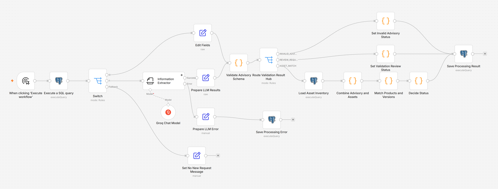

# n8n Security Advisory Triage

[English](README.md) · **Deutsch**

Ein n8n-Prototyp, der Sicherheitshinweise von Softwareherstellern (Security Advisories) mit einem Asset-Inventar abgleicht und für jeden Hinweis festhält, ob Kunden betroffen sein könnten. Ein Sprachmodell liest den Freitext; jede Entscheidung treffen feste Regeln.



## Das Szenario

Ein IT-Dienstleister (MSP, Managed Service Provider) betreut die IT vieler kleiner Betriebe. Softwarehersteller verschicken Sicherheitshinweise per E-Mail, als PDF, über Portale oder als Feed. Bei jedem Hinweis muss jemand herausfinden, welche Kunden das betroffene Produkt in einer betroffenen Version einsetzen. Der Prototyp automatisiert diesen Schritt – vom eingehenden Hinweis bis zur gespeicherten, nachvollziehbaren Entscheidung. Er spielt keine Updates ein und schreibt keine Kunden an.

Alle Firmen, Produkte, Kunden und Hinweise sind erfunden; alle Daten sind synthetisch.

## So funktioniert es

**Workflow 1 – Advisory Input:** Webhook → Vorgang mit Status `NEW` speichern → Antwort `HTTP 202`.

**Workflow 2 – Advisory Processing (19 Knoten):**

1. ältesten `NEW`-Vorgang übernehmen (`FOR UPDATE SKIP LOCKED`)
2. strukturierte Quellen: Felder direkt zuordnen, **ohne** Sprachmodell – Freitext: Sprachmodell liest Hersteller, Produkt, Versionen und Belegstellen heraus
3. Prüfung in Python: Pflichtfelder, Versionsregeln, jede Belegstelle muss **wörtlich** im Originaltext stehen
4. exakter Abgleich von Produkt und Version mit dem Asset-Inventar
5. feste Regeln setzen einen von vier Status und speichern das Ergebnis

| Status | Bedeutung |
| --- | --- |
| `POTENTIALLY_AFFECTED` | Produkt und betroffene Version passen zu mindestens einem Asset |
| `REVIEW_REQUIRED` | Angaben fehlen, sind unklar oder widersprüchlich |
| `NO_MATCH_FOUND` | kein Treffer im vorhandenen Inventar – keine Entwarnung |
| `INVALID_ADVISORY` | kein Sicherheitshinweis (z. B. Release Notes, Werbung) |

**Entwurfsentscheidungen**

- Das Sprachmodell extrahiert nur. Es sieht das Inventar nie und entscheidet weder Status noch Treffer noch Weiterleitung.
- Belegstellen werden gegen den Originaltext geprüft; so lässt sich die Extraktion zurückverfolgen.
- Strukturierte Quellen laufen am Sprachmodell vorbei.
- Jeder Vorgang wird vor der Verarbeitung gespeichert; technische Fehler enden als `ERROR` und lassen sich wiederholen.
- Sind Angaben unklar, lautet das Ergebnis `REVIEW_REQUIRED` – geraten wird nicht.

Details: [docs/architecture.de.md](docs/architecture.de.md)

## Ergebnisse

Im ursprünglichen Testaufbau erreichen alle 15 synthetischen Testfälle (4 × betroffen, 4 × kein Treffer, 4 × Prüfung, 3 × kein Sicherheitshinweis; über E-Mail, PDF, Portal und Telefon) den erwarteten Status. Laufzeit pro Vorgang: etwa 3,4–5,4 s mit einem Cloud-Modell (`openai/gpt-oss-20b` über Groq, Testaufbau).

Im Docker-Lauf mit n8n 2.42.7 erreichen 14 von 15 Fällen den erwarteten Status. PA-03 endet reproduzierbar als `REVIEW_REQUIRED` statt `POTENTIALLY_AFFECTED`: Der Abgleich findet B-HMI-01, aber das Modell trägt „Andere Versionen wurden … nicht bewertet“ als fehlende Information ein, und `Decide Status` leitet jede fehlende Angabe zur Prüfung. Die Abweichung geht in die vorsichtige Richtung (kein übersehener Treffer). Prompt und Regeln wurden nicht nachgeschärft, weil jede Änderung einen vollständigen Regressionslauf erfordert. Details: [docs/architecture.de.md](docs/architecture.de.md#wiederholung-im-docker-aufbau).

## Aufbau des Repositorys

```text
workflows/          n8n-Exporte von Workflow 1 und 2
sql/                Schema und synthetisches Asset-Inventar
examples/requests/  die 15 Testfälle als Webhook-Anfragen
scripts/            n8n einrichten, Testfall verschicken (bash, PowerShell)
data/               Testmeldungen mit erwarteten Ergebnissen
docs/               Architektur (Englisch, Deutsch)
notebooks/          beide Workflows als reines Python, läuft ohne n8n
assets/             Screenshots
```

## Lokal ausführen

Voraussetzungen: Docker und ein API-Key für Groq. Andere Chat-Modelle können den Groq-Knoten in n8n ersetzen; getestet ist nur Groq.

1. `cp .env.example .env` und `POSTGRES_PASSWORD`, `N8N_RUNNERS_AUTH_TOKEN` (beliebige Zufallszeichenkette) und `GROQ_API_KEY` setzen.
2. `docker compose up -d` – startet PostgreSQL (Schema und Inventar werden beim ersten Start angelegt), n8n und die Task-Runner für die Code-Knoten (Workflow 2 enthält einen Python-Knoten, der den separaten Container `n8nio/runners` braucht).
3. Zugangsdaten und Workflows importieren, Workflow 1 aktivieren:
   ```bash
   ./scripts/setup-n8n.sh                # PowerShell: .\scripts\setup-n8n.ps1
   ```
   Das Skript legt die Zugangsdaten **Postgres account** und **Groq account** aus `.env` an, importiert beide Workflows und startet n8n neu. Ein erneuter Aufruf überspringt, was schon vorhanden ist.
4. Einen Testfall an den Produktions-Webhook von Workflow 1 schicken:
   ```bash
   ./scripts/send-case.sh PA-01          # PowerShell: .\scripts\send-case.ps1 PA-01
   ```
   Die Antwort ist `202` mit der `request_id`.
5. http://localhost:5678 öffnen, das lokale n8n-Konto anlegen, Workflow 2 öffnen und auf **Execute workflow** klicken. Jeder Lauf verarbeitet den ältesten Vorgang mit Status `NEW`. Das Ergebnis steht in der Datenbank:
   ```bash
   docker compose exec postgres psql -U advisory -d advisory \
     -c "SELECT request_id, status, matched_assets FROM advisory_requests;"
   ```

Mit dem kostenlosen Groq-Zugang (8.000 Tokens pro Minute) Workflow 2 höchstens etwa einmal pro Minute starten. Schnellere Läufe überschreiten das Ratenlimit, enden als `ERROR` und lassen sich wiederholen:

```bash
docker compose exec postgres psql -U advisory -d advisory \
  -c "UPDATE advisory_requests SET processing_status = 'NEW' WHERE processing_status = 'ERROR';"
```

Der Prototyp wurde gegen ein gehostetes PostgreSQL (Supabase) entwickelt. Schema und Docker-Aufbau sind für dieses Repository aus den Workflow-Exporten nachgebaut. Der vollständige Docker-Lauf wurde mit n8n 2.42.7, PostgreSQL 16 und `openai/gpt-oss-20b` über Groq von Anfang bis Ende wiederholt: Einrichtung, Import und alle 15 Webhook-Anfragen funktionieren wie beschrieben. Ergebnis: siehe [Ergebnisse](#ergebnisse).

Ohne n8n: [`notebooks/workflow_in_python.ipynb`](notebooks/workflow_in_python.ipynb) führt dieselbe Logik mit der Python-Standardbibliothek aus.

## Grenzen

Workflow 2 wird von Hand gestartet, der Webhook hat keine Authentifizierung, und der strukturierte Weg erwartet Eingaben, die schon dem Zielschema entsprechen. Die vollständige Liste und der Weg in den Betrieb stehen in [docs/architecture.de.md](docs/architecture.de.md#8-grenzen-des-prototyps).

## Sprache

Das Szenario spielt bei einem deutschen IT-Dienstleister. Testmeldungen, Extraktions-Prompt und Code-Kommentare sind deshalb deutsch; die Dokumentation gibt es auf Englisch und Deutsch.
