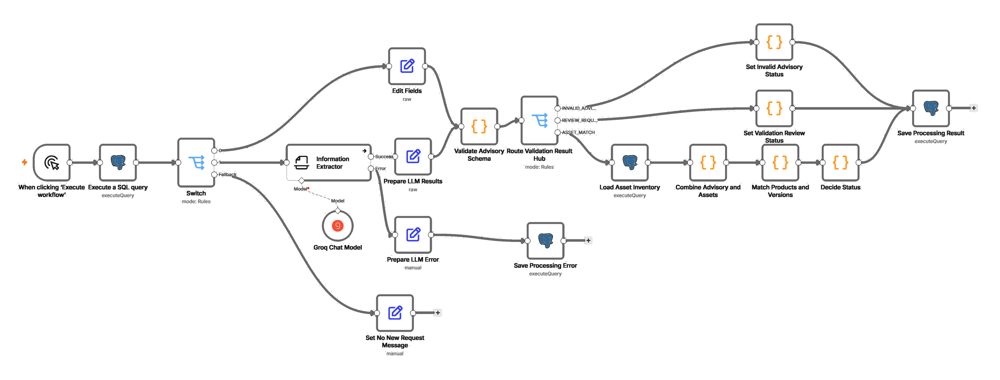
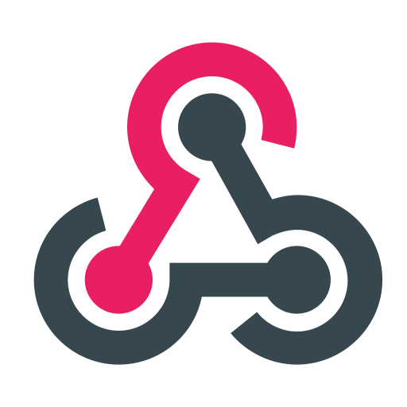

# n8n Security Advisory Triage

**English** · [Deutsch](README.de.md)

An n8n prototype that checks vendor security advisories against an asset inventory and records, for each advisory, whether customers may be affected. A language model reads the free text; fixed rules make every decision.

<picture>
  <source media="(prefers-color-scheme: dark)" srcset="assets/screenshots/workflow2-dark.png">
  
</picture>

## The scenario

A managed service provider (MSP) looks after the IT of many small businesses. Software vendors send security advisories by e-mail, as PDF, through portals or as feeds. For each advisory someone has to find out which customers run the affected product in an affected version. The prototype automates this step – from the incoming advisory to a stored, traceable decision. It does not patch and does not contact customers.

All companies, products, customers and advisories are fictional; all data is synthetic.

## How it works

**Workflow 1 – Advisory Input:**

 Webhook →  Edit Fields →  store the request with status `NEW` → reply `HTTP 202`

**Workflow 2 – Advisory Processing (19 nodes):**  started manually

1.  claim the oldest `NEW` request (`FOR UPDATE SKIP LOCKED`)
2.  structured sources: map fields directly, **without** LLM – free text: LLM extracts vendor, product, versions and evidence
3. Python validation: required fields, version rules, every evidence quote must occur **verbatim** in the original text
4. exact match of product and version against the asset inventory
5. fixed rules set one of four statuses,  the result is stored

| Status | Meaning |
| --- | --- |
| `POTENTIALLY_AFFECTED` | product and affected version match at least one asset |
| `REVIEW_REQUIRED` | information missing, unclear or contradictory |
| `NO_MATCH_FOUND` | no match in the existing inventory – not an all-clear |
| `INVALID_ADVISORY` | not a security advisory (e.g. release notes, marketing) |

**Design decisions**

- The LLM only extracts. It never sees the inventory and never decides status, matches or routing.
- Evidence is checked against the original text, so the extraction can be traced back.
- Structured sources skip the LLM.
- Every request is stored before processing; technical errors end as `ERROR` and can be repeated.
- When information is unclear, the result is `REVIEW_REQUIRED` – nothing is guessed.

Details: [docs/architecture.md](docs/architecture.md)

## Results

In the original test setup, all 15 synthetic test cases (4 × affected, 4 × no match, 4 × review, 3 × no advisory; via e-mail, PDF, portal and phone) reach the expected status. Runtime per request: about 3.4–5.4 s with a cloud model (`openai/gpt-oss-20b` via Groq, test setup).

In the Docker run with n8n 2.42.7, 14 of 15 cases reach the expected status. PA-03 reproducibly ends as `REVIEW_REQUIRED` instead of `POTENTIALLY_AFFECTED`: the match finds B-HMI-01, but the model enters "Andere Versionen wurden … nicht bewertet" (other versions were not assessed) as missing information, and `Decide Status` routes every missing item to review. The deviation goes in the cautious direction (no missed match). Prompt and rules were not tightened, because every change requires a full regression run. Details: [docs/architecture.md](docs/architecture.md#repeat-with-the-docker-setup).

## Repository

```text
workflows/          n8n exports of workflow 1 and 2
sql/                schema and synthetic asset inventory
examples/requests/  the 15 test cases as webhook requests
scripts/            set up n8n, send a test case (bash, PowerShell)
data/               test advisories with expected results (German)
docs/               architecture (English, German)
notebooks/          both workflows as plain Python, runs without n8n
assets/             screenshots
```

## Run it locally

Requirements: Docker and an API key for Groq. Other chat models can replace the Groq node in n8n; only Groq has been tested.

1. `cp .env.example .env` and set `POSTGRES_PASSWORD`, `N8N_RUNNERS_AUTH_TOKEN` (any random string) and `GROQ_API_KEY`.
2. `docker compose up -d` – starts PostgreSQL (schema and inventory are created on first start), n8n and the task runners for the Code nodes (workflow 2 contains a Python node, which needs the separate `n8nio/runners` container).
3. Import credentials and workflows and activate workflow 1:
   ```bash
   ./scripts/setup-n8n.sh                # PowerShell: .\scripts\setup-n8n.ps1
   ```
   The script creates the credentials **Postgres account** and **Groq account** from `.env`, imports both workflows and restarts n8n. Running it again skips what already exists.
4. Send a test case to the production webhook of workflow 1:
   ```bash
   ./scripts/send-case.sh PA-01          # PowerShell: .\scripts\send-case.ps1 PA-01
   ```
   The reply is `202` with the `request_id`.
5. Open http://localhost:5678, create the local n8n account, open workflow 2 and click **Execute workflow**. Each run processes the oldest request with status `NEW`. The result is in the database:
   ```bash
   docker compose exec postgres psql -U advisory -d advisory \
     -c "SELECT request_id, status, matched_assets FROM advisory_requests;"
   ```

With Groq's free tier (8,000 tokens per minute), start workflow 2 at most about once per minute. Faster runs exceed the rate limit, end as `ERROR` and can be repeated:

```bash
docker compose exec postgres psql -U advisory -d advisory \
  -c "UPDATE advisory_requests SET processing_status = 'NEW' WHERE processing_status = 'ERROR';"
```

The prototype was developed against a hosted PostgreSQL (Supabase). Schema and Docker setup were reconstructed from the workflow exports for this repository. The complete Docker run was repeated end to end with n8n 2.42.7, PostgreSQL 16 and `openai/gpt-oss-20b` via Groq: setup, import and all 15 webhook requests work as described. Result: see [Results](#results).

Without n8n: [`notebooks/workflow_in_python.ipynb`](notebooks/workflow_in_python.ipynb) runs the same logic with the Python standard library.

## Limitations

Workflow 2 is started manually, the webhook has no authentication, and the structured path expects input that already matches the target schema. The full list and the path to production are in [docs/architecture.md](docs/architecture.md#8-limitations-of-the-prototype).

## License

[MIT](LICENSE). Node icons: [n8n](https://n8n.io); PostgreSQL logo: PostgreSQL Global Development Group.

## Language

The scenario is set at a German MSP. Test advisories, the extraction prompt and code comments are therefore in German; the documentation is available in English and German.
