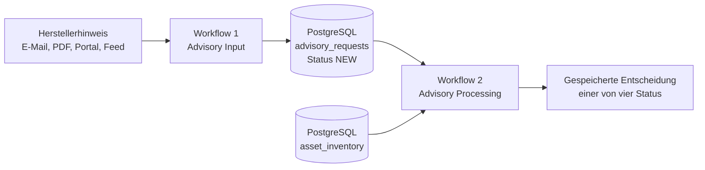
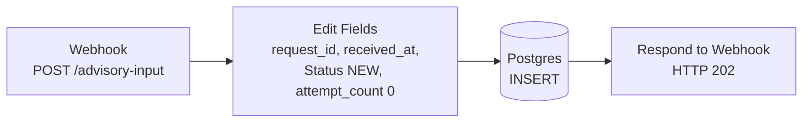

# Architektur

[English](architecture.md) · **Deutsch**

Dieses Dokument beschreibt die beiden n8n-Workflows des Prototyps, das Datenmodell, die Entscheidungsregeln, die Testergebnisse und was ein Produktivbetrieb zusätzlich bräuchte. Alle Firmen, Produkte, Kunden und Meldungen sind erfunden; alle Daten sind synthetisch.

## 1. Aufgabe und Abgrenzung

Ein IT-Dienstleister (MSP, Managed Service Provider) betreut die IT vieler kleiner und mittlerer Betriebe. Softwarehersteller veröffentlichen Sicherheitshinweise (Security Advisories) per E-Mail, als PDF, in Portalen oder als Feed. Bei jedem Hinweis stellt sich dieselbe Frage: Welche Kunden setzen das betroffene Produkt in einer betroffenen Version ein?

Der Prototyp automatisiert einen abgeschlossenen Ablauf:

> Herstellerhinweis → gespeicherter Vorgang → Extraktion der Fakten → Prüfung → fester Abgleich mit dem Asset-Inventar → gespeicherte Entscheidung

Er ist **kein** Vulnerability-Management-System. Er spielt keine Updates ein, trifft keine endgültige Risikobewertung und schreibt keine Kunden an.

Die zentrale Regel: **Die KI liest, Regeln entscheiden.** Das Sprachmodell liest nur unstrukturierten Text und gibt Fakten zurück. Status, betroffene Assets und Weiterleitung legen feste Regeln in n8n fest.

## 2. Rollen im Szenario

| Rolle | Beschreibung |
| --- | --- |
| IT-Dienstleister (MSP) | betreibt den Prozess, pflegt das Asset-Inventar, trifft alle Entscheidungen |
| Kunden A, B, C | Betriebe, deren Systeme im Inventar stehen: Werkzeugbau, Verpackungstechnik, Medizintechnik-Zulieferer |
| Hersteller | veröffentlichen die Hinweise; erfunden: Musterwerk Systems, SicherWerk Software, Anlagenblick, Warenstrom Software |
| Entwickler | baut, testet und wartet die Workflows |

## 3. Überblick



Eingang und Verarbeitung sind bewusst getrennt. Jeder Vorgang wird gespeichert, bevor die Verarbeitung beginnt. Scheitert ein späterer Schritt, geht nichts verloren, und jeder Vorgang lässt sich erneut verarbeiten.

## 4. Datenmodell

Die Felder gliedern sich in vier Gruppen.

**A – Eingang**

`request_id`, `received_at`, `source_channel`, `payload_type` (`structured` | `unstructured`), `raw_text`

**B – Fakten aus dem Hinweis** (vom Sprachmodell oder aus der strukturierten Zuordnung)

`is_security_advisory`, `advisory_reference`, `cve_ids[]`, `affected_products[]`, `severity_stated_by_source`, `recommended_action`, `missing_information[]`, `evidence_quotes[]`

Jeder Eintrag in `affected_products[]`: `vendor`, `product`, `affected_version_raw`, `version_rule_type`, `lower_bound`, `lower_inclusive`, `upper_bound`, `upper_inclusive`, `fixed_version`

**C – Entscheidung** (nur Regeln, nie das Sprachmodell)

`status`, `matched_assets[]` (`asset_id`, `inventory_product`, `installed_version`, `match_reason`), `reason_codes[]`, `decided_at`

**D – Verarbeitung und Nachweis**

`extraction_method`, `model_provider`, `model_name`, `processing_status` (`NEW` → `PROCESSING` → `DONE` | `ERROR`), `attempt_count`, `error_detail`, `processed_at`, `schema_version`

**Tabellen**

- `public.advisory_requests` – eine Zeile pro Vorgang; `request_id TEXT PRIMARY KEY`; Constraints für die zulässigen Werte von `payload_type` und `processing_status` sowie `attempt_count >= 0`; `schema_version` hat den Standardwert `1`.
- `public.asset_inventory` – eine Zeile pro Produktinstallation; `asset_id` ist eindeutig; Hersteller, Produkt und installierte Version sind getrennte Felder. Das Testinventar enthält sieben Installationen bei drei Kunden.

## 5. Workflow 1 – Advisory Input



- `request_id` ist `'REQ-' + Ausführungs-ID`, `received_at` die aktuelle Zeit, `processing_status` ist `NEW`, `attempt_count` ist `0`. Die technische `body`-Hülle wird nicht weitergegeben.
- Die Antwort geht erst nach erfolgreichem INSERT hinaus: `{"accepted": true, "request_id": …, "processing_status": "NEW"}`. Der Absender erhält die Bestätigung, dass der Vorgang gespeichert ist, und wartet nicht auf die Verarbeitung.

## 6. Workflow 2 – Advisory Processing

<picture>
  <source media="(prefers-color-scheme: dark)" srcset="../assets/screenshots/workflow2-dark.png">
  
</picture>

19 Knoten:

```text
Manual Trigger
→ Execute a SQL query                     ältesten NEW-Vorgang übernehmen
→ Switch
  ├─ strukturiert   → Edit Fields           Zuordnung ohne Sprachmodell
  ├─ unstrukturiert → Information Extractor Extraktion mit Sprachmodell
  │                   ├─ Erfolg → Prepare LLM Results
  │                   └─ Fehler → Prepare LLM Error → Save Processing Error
  └─ kein NEW-Vorgang → Set No New Request Message
                     ↓
        Validate Advisory Schema          Python
        → Route Validation Result Hub
          ├─ INVALID_ADVISORY → Set Invalid Advisory Status
          ├─ REVIEW_REQUIRED  → Set Validation Review Status
          └─ ASSET_MATCH      → Load Asset Inventory
                              → Combine Advisory and Assets
                              → Match Products and Versions
                              → Decide Status
                     ↓
        Save Processing Result
```

### 6.1 Vorgang übernehmen

Eine einzige SQL-Anweisung holt den ältesten Vorgang mit Status `NEW` (`ORDER BY received_at, request_id`, `FOR UPDATE SKIP LOCKED`, `LIMIT 1`), setzt ihn auf `PROCESSING` und erhöht `attempt_count`. Zwei parallele Läufe können nie denselben Vorgang übernehmen.

Gibt es keinen `NEW`-Vorgang, endet der Workflow mit `result_code = NO_NEW_REQUEST`. Eine leere Warteschlange ist ein normaler Zustand und löst keine Warnung aus.

### 6.2 Zwei Wege der Extraktion

Der Knoten `Switch` liest `payload_type`:

- **strukturiert** – die Felder werden direkt Gruppe B zugeordnet. Das Sprachmodell ist nicht beteiligt.
- **unstrukturiert** – der `Information Extractor` erhält **nur `raw_text`**. Das Asset-Inventar geht nie an das Modell.

Testaufbau für den Weg mit Sprachmodell: `openai/gpt-oss-20b` über Groq, Temperature `0`, höchstens 3.000 Tokens. Das Extraktionsschema beschreibt jedes mehrdeutige Feld: Der Hersteller darf nicht aus dem Produktnamen oder der Absenderdomain abgeleitet werden, Produktnamen kommen ohne Versionsnummer zurück, Versionsregeln folgen einer festen Konvention.

### 6.3 Prüfung

Ein Python-Knoten prüft:

- Pflichtfelder und Datentypen,
- ob Regeltyp, Grenzen und Inklusiv-Angaben der Versionsregel zusammenpassen,
- ob jeder Eintrag in `evidence_quotes[]` nicht leer ist und **wörtlich** in `raw_text` vorkommt.

Eindeutige Strukturabweichungen werden fest korrigiert, zum Beispiel wird eine Regel mit Unter- und Obergrenze zu `range`. Jede Korrektur steht in `normalization_notes[]`; `raw_text` und die Belegstellen bleiben unverändert.

Weiterleitung, der erste Treffer entscheidet:

1. `is_security_advisory` ist falsch → `INVALID_ADVISORY`
2. Schema oder Belegstellen ungültig → `REVIEW_REQUIRED`
3. sonst → Abgleich mit dem Inventar

### 6.4 Abgleich von Produkt und Version

Hersteller und Produkt werden nach `trim()` und Kleinschreibung verglichen. Der Abgleich ist exakt; es gibt keinen unscharfen oder teilweisen Namensvergleich.

| `version_rule_type` | Prüfung |
| --- | --- |
| `exact` | gleich `lower_bound` (ersatzweise `upper_bound`, dann die erste numerische Version in `affected_version_raw`) |
| `range` | zwischen den Grenzen, unter Beachtung von `lower_inclusive` und `upper_inclusive` |
| `before` | `installed_version < upper_bound` |
| `through` | `installed_version <= upper_bound` |
| `all` | jede Installation des Produkts gilt als möglicherweise betroffen |
| `unknown` | keine Versionsentscheidung → `REVIEW_REQUIRED` |

Versionen mit Punkten werden Segment für Segment verglichen; fehlende Segmente zählen als `0`. Eine nicht lesbare Version wird nie geraten, sie führt zu `REVIEW_REQUIRED`. Das gilt nur, wenn das Produkt überhaupt im Inventar steht – sonst lautet das Ergebnis `NO_MATCH_FOUND`, auch bei unklarer Version.

### 6.5 Status

| Status | Bedeutung | Vorgesehene Folgeaktion |
| --- | --- | --- |
| `POTENTIALLY_AFFECTED` | Produkt und betroffene Version passen zu mindestens einem Asset | Ticket anlegen, technisch prüfen |
| `REVIEW_REQUIRED` | Angaben fehlen, sind unklar oder widersprüchlich | Arbeitskorb für menschliche Prüfung |
| `NO_MATCH_FOUND` | kein Treffer **im vorhandenen Inventar** | protokollieren; das ist keine Entwarnung |
| `INVALID_ADVISORY` | kein Sicherheitshinweis (z. B. Release Notes, Werbung) | schließen oder an den regulären Update-Prozess übergeben |

`Save Processing Result` speichert die Gruppen B und C, setzt `processing_status = DONE` und `processed_at`.

### 6.6 Fehlerweg

Schlägt der Aufruf des Sprachmodells fehl, setzt `Save Processing Error` den Status auf `ERROR` und speichert `error_detail` und `processed_at` (parametrisiertes SQL). Der Vorgang bleibt in der Datenbank, kann auf `NEW` zurückgesetzt und erneut verarbeitet werden.

## 7. Tests

15 synthetische Hinweise decken alle vier Status und die Eingangswege E-Mail, PDF, Portal und Telefon ab: 4 × `POTENTIALLY_AFFECTED`, 4 × `NO_MATCH_FOUND`, 4 × `REVIEW_REQUIRED`, 3 × `INVALID_ADVISORY`. Die Texte reichen von automatisch erzeugten Standardmeldungen über strukturierte Bulletins bis zu frei formulierten Nachrichten. Testdaten: [`data/synthetic_security_advisories.md`](../data/synthetic_security_advisories.md).

| Fall | Erwartet | Ergebnis |
| --- | --- | --- |
| PA-01 | `POTENTIALLY_AFFECTED` | A-REM-01, A-REM-02, C-REM-01; B-REM-01 (bereits behobene Version) richtig ausgeschlossen |
| PA-02 | `POTENTIALLY_AFFECTED` | A-BKP-01 |
| PA-03 | `POTENTIALLY_AFFECTED` | B-HMI-01 (nach Korrektur der Trennung Produkt/Version im Prompt) |
| PA-04 | `POTENTIALLY_AFFECTED` | C-ERP-01; Obergrenze einschließlich richtig behandelt |
| NM-01 … NM-04 | `NO_MATCH_FOUND` | `PRODUCT_NOT_IN_INVENTORY`; NM-04 trotz unbekannter Version |
| RR-01 … RR-04 | `REVIEW_REQUIRED` | `VERSION_INFORMATION_UNCLEAR` |
| IA-01 … IA-03 | `INVALID_ADVISORY` | `NOT_A_SECURITY_ADVISORY` |

**Alle 15 Fälle erreichen im finalen Workflow den erwarteten Status** (ursprünglicher Testaufbau; zur Wiederholung im Docker-Aufbau siehe unten). Korrekturen während der Tests betrafen nur die Extraktionsanweisung; Statuslogik und Abgleich blieben fest geregelt.

Weitere Prüfungen:

- Versionsregel `all`: Alle vier Installationen des betroffenen Produkts wurden ausgegeben.
- Fünf zusätzliche, unterschiedlich genaue Hinweise: vier wie erwartet; eine sehr vage Meldung wurde als `REVIEW_REQUIRED` eingestuft – das vorsichtige Ergebnis.
- Fehlerweg: mit einem Token-Limit von 1 erzwungen, danach erfolgreich wiederholt.
- Die wörtliche Belegprüfung hat eine fehlerhafte Zeichenkodierung in einem Eingangstext erkannt (Ersatzzeichen statt Umlauten).
- Laufzeit pro Vorgang: etwa 3,4–5,4 s, Median etwa 4,3 s (synthetische Daten, Cloud-Modell).

### Wiederholung im Docker-Aufbau

Aufbau dieses Repositorys: n8n 2.42.7 mit externen Task-Runnern, PostgreSQL 16, `openai/gpt-oss-20b` über Groq (kostenloser Zugang), Workflows und Zugangsdaten mit `scripts/setup-n8n` importiert. Alle 15 Fälle wurden an den Produktions-Webhook geschickt und mit Workflow 2 verarbeitet.

- Endstand: 14 von 15 Fällen erreichen den erwarteten Status, bei PA-01, PA-02 und PA-04 mit den erwarteten Assets.
- **PA-03** endet reproduzierbar als `REVIEW_REQUIRED` statt `POTENTIALLY_AFFECTED` (zwei Läufe). Der Abgleich findet B-HMI-01, aber das Modell trägt „Andere Versionen wurden … nicht bewertet“ in `missing_information` ein, und `Decide Status` leitet jede fehlende Angabe zur Prüfung. Die Abweichung geht in die vorsichtige Richtung (kein übersehener Treffer). Prompt und Regeln wurden nicht nachgeschärft, weil jede Änderung einen vollständigen Regressionslauf erfordert.
- Abweichungen, die sich in einem zweiten Lauf nicht wiederholten: PA-01 und IA-02 – das Modell hat das Limit von 3.000 Tokens für Reasoning verbraucht, ohne Antwort (PA-01 danach `INVALID_ADVISORY`, IA-02 `ERROR`); NM-04 – ein Beleg endete mit Punkt statt mit dem Komma des Originals, die Belegprüfung hat ihn abgelehnt (`REVIEW_REQUIRED`).
- Ratenlimit: Der kostenlose Groq-Zugang erlaubt 8.000 Tokens pro Minute, eine Anfrage reserviert bis zu etwa 5.500. Schnell aufeinanderfolgende Läufe endeten über den Fehlerweg als `ERROR` und liefen nach Zurücksetzen auf `NEW` durch.
- Laufzeit pro Vorgang ohne Ratenlimit: etwa 5–8 s.

## 8. Grenzen des Prototyps

- Workflow 2 wird von Hand gestartet.
- Der Webhook hat keine Authentifizierung; der Knoten des Sprachmodells erlaubt alle HTTP-Domains.
- `payload_type` setzt der Absender. Im Betrieb sollte der Eingangskanal ihn festlegen, im Zweifel `unstructured`.
- Der strukturierte Weg erwartet Eingaben, die schon dem Zielschema entsprechen (`JSON.parse` ohne Absicherung). Echte Feeds brauchen eine Zuordnung pro `source_channel` vor der gemeinsamen Prüfung; Formate ohne Zuordnung sollten an das Sprachmodell gehen.
- Das Sprachmodell läuft als Testaufbau über eine Cloud-API. Für den Betrieb ist ein lokal betriebenes Modell vorgesehen.
- Ungewöhnliche Versionsformate sind nicht systematisch getestet.
- Noch keine Wiederholungsgrenzen, keine Alarmierung, keine automatisierten Regressionstests. Jede Änderung an Prompt oder Regeln erfordert einen neuen Lauf aller 15 Fälle.
- `NO_MATCH_FOUND` ist nur so verlässlich wie das Asset-Inventar.

## 9. Weg in den Betrieb

### 9.1 Eingang

| Kanal des Herstellers | Technische Übergabe |
| --- | --- |
| E-Mail | überwachtes Service-Postfach, E-Mail-Trigger in n8n |
| Herstellerportal | Portal-API oder Weiterleitung an das Postfach |
| strukturierter Feed | API oder Webhook, direkte Feldzuordnung ohne Sprachmodell |
| PDF-Anhang | Original speichern, dann Text extrahieren |
| manuelle Meldung | vorhandenes Ticket- oder Serviceportal |

Die vorhandene Mail- und Ticket-Infrastruktur bleibt vor n8n geschaltet. Vor der Verarbeitung sollten Eingänge auf Größe, Dateityp und Dubletten geprüft werden; der sichtbare Absender allein beweist keine Echtheit.

### 9.2 Start der Verarbeitung

1. **Sofort:** Workflow 1 startet Workflow 2 nach erfolgreichem INSERT.
2. **Nachlauf:** Ein zeitgesteuerter Workflow holt Vorgänge ab, die noch auf `NEW` stehen.

### 9.3 Asset-Inventar

Im Betrieb kommt das Inventar aus den Systemen des IT-Dienstleisters: RMM, CMDB, Software-Inventarisierung oder Kundendokumentation. Jede Installation braucht mindestens `asset_id`, `customer_id`, `vendor`, `product`, `installed_version`, `inventory_updated_at` und ein zuständiges Team.

### 9.4 Ergebnisse und Tickets

Die Entscheidung wird zuerst in PostgreSQL gespeichert – die Datenbank ist der Nachweis. Danach entsteht ein Ticket im vorhandenen Ticket- oder PSA-System des IT-Dienstleisters:

- ein Hauptvorgang pro Hinweis,
- ein Ticket pro betroffenem Kunden,
- `request_id` als Idempotenzschlüssel, damit ein wiederholter Lauf keine doppelten Tickets erzeugt.

### 9.5 Menschliche Prüfung und Folgeprozesse

- `POTENTIALLY_AFFECTED` ist ein begründeter Prüfhinweis, keine endgültige Risikobewertung.
- n8n kann pro betroffenem Betrieb einen Entwurf für die Kundennachricht erzeugen. Verschickt wird er erst nach Freigabe durch einen Menschen.
- Das Einspielen von Updates ist ein eigener, kontrollierter Change-Prozess (Sicherung, Wartungsfenster, Update, Prüfung, Inventar aktualisieren).
- Kriterien für die Eskalation dringender Fälle legen Security-Fachleute fest, nicht das Sprachmodell.

### 9.6 Verantwortung

| Aufgabe | Entwickler | IT-Dienstleister | Kunde |
| --- | --- | --- | --- |
| Workflows und Anbindungen bauen | verantwortlich | liefert Anforderungen | – |
| n8n betreiben | unterstützt oder betreibt per Vertrag | verantwortlich | – |
| Asset-Daten pflegen | stellt die Schnittstelle bereit | verantwortlich | bestätigt bei Bedarf |
| Abgleich- und Eskalationsregeln festlegen | setzt um | legt mit Security-Fachleuten fest | – |
| Betroffenheit eines Kunden bestätigen | – | verantwortlich | bringt lokale Kenntnis ein |
| Kundennachricht freigeben | – | verantwortlich | Empfänger |
| Update einspielen | nur bei eigenem Auftrag | verantwortlich | ermöglicht die Wartung |

### 9.7 Sicherheit und Betrieb

Trennung der Kunden, Rollen und Rechte, geschützte Zugangsdaten, freigegebener Modell-Endpunkt und Datensparsamkeit, Aufbewahrungsfristen, Sicherung, Überwachung und Alarmierung, Wiederholungsregeln mit Fehler-Arbeitskorb, geschützte Webhooks, Protokollierung von Freigaben und Änderungen sowie ein Freigabeprozess für Änderungen an Workflows, Prompts und Regeln.

Herstellertexte sind nicht vertrauenswürdige Eingaben. Das Sprachmodell extrahiert deshalb nur. Es hat keine Werkzeuge und keine Befugnis über Status, Kundenkontakt oder Freigaben.

## 10. Ausblick: Standards

- **CSAF** (Common Security Advisory Framework) ist der OASIS-Standard für maschinenlesbare Sicherheitshinweise und wird vom BSI gefördert. CSAF-Feeds wären ein naheliegender Eingang für den strukturierten Weg.
- **VEX** (Vulnerability Exploitability eXchange) sagt aus, ob ein Produkt betroffen ist. Die vier Status ließen sich pro Kunde als VEX-ähnliche Aussagen ausgeben.

Beides ist im Prototyp nicht umgesetzt.
