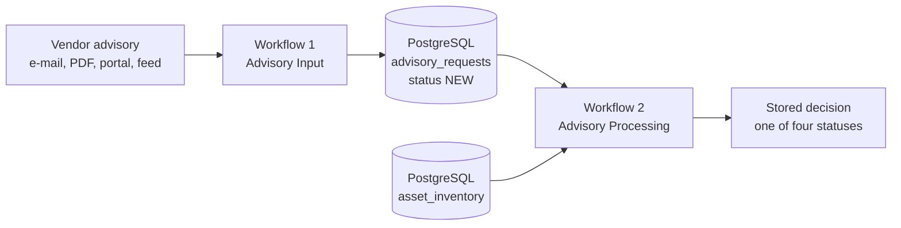
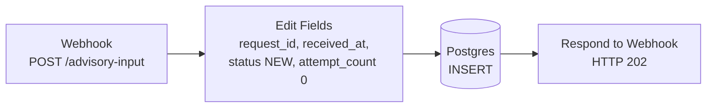

# Architecture

**English** · [Deutsch](architecture.de.md)

This document describes the two n8n workflows of the prototype, the data model, the decision rules, the test results and what a production setup would additionally need. All companies, products, customers and advisories are fictional; all data is synthetic.

## 1. Problem and scope

A managed service provider (MSP) looks after the IT systems of many small and medium-sized businesses. Software vendors publish security advisories by e-mail, as PDF, in portals or as feeds. For every advisory someone has to answer the same question: which customers run the affected product in an affected version?

The prototype automates one closed process:

> vendor advisory → stored request → fact extraction → validation → deterministic match against the asset inventory → stored decision

It is **not** a vulnerability management system. It does not patch, does not make a final risk assessment and does not contact customers.

The central design rule: **the LLM extracts, rules decide.** The language model only reads unstructured text and returns facts. Status, matched assets and routing are determined by fixed rules in n8n.

## 2. Roles in the scenario

| Role | Description |
| --- | --- |
| MSP (IT service provider) | operates the process, owns the asset inventory, makes all decisions |
| Customers A, B, C | businesses whose systems are in the inventory: tool making, packaging technology, medical-device supplier |
| Vendors | publish advisories; fictional: Musterwerk Systems, SicherWerk Software, Anlagenblick, Warenstrom Software |
| Developer | builds, tests and maintains the workflows |

## 3. Overview



Intake and processing are separated on purpose. Every request is stored before any processing starts, so nothing is lost when a later step fails, and every request can be processed again.

## 4. Data model

The fields fall into four groups.

**A – Intake**

`request_id`, `received_at`, `source_channel`, `payload_type` (`structured` | `unstructured`), `raw_text`

**B – Advisory facts** (from the LLM or from the structured mapping)

`is_security_advisory`, `advisory_reference`, `cve_ids[]`, `affected_products[]`, `severity_stated_by_source`, `recommended_action`, `missing_information[]`, `evidence_quotes[]`

Each entry in `affected_products[]`: `vendor`, `product`, `affected_version_raw`, `version_rule_type`, `lower_bound`, `lower_inclusive`, `upper_bound`, `upper_inclusive`, `fixed_version`

**C – Decision** (rules only, never the LLM)

`status`, `matched_assets[]` (`asset_id`, `inventory_product`, `installed_version`, `match_reason`), `reason_codes[]`, `decided_at`

**D – Processing and audit**

`extraction_method`, `model_provider`, `model_name`, `processing_status` (`NEW` → `PROCESSING` → `DONE` | `ERROR`), `attempt_count`, `error_detail`, `processed_at`, `schema_version`

**Tables**

- `public.advisory_requests` – one row per request; `request_id TEXT PRIMARY KEY`; constraints on the allowed values of `payload_type` and `processing_status` and on `attempt_count >= 0`; `schema_version` defaults to `1`.
- `public.asset_inventory` – one row per product installation; `asset_id` is unique; vendor, product and installed version are separate fields. The test inventory holds seven installations at three customers.

## 5. Workflow 1 – Advisory Input



- `request_id` is `'REQ-' + execution id`, `received_at` is the current time, `processing_status` is `NEW`, `attempt_count` is `0`. The technical `body` wrapper is not passed on.
- The response is sent only after the INSERT has succeeded: `{"accepted": true, "request_id": …, "processing_status": "NEW"}`. The sender gets a confirmation that the request is stored and does not wait for processing.

## 6. Workflow 2 – Advisory Processing

<picture>
  <source media="(prefers-color-scheme: dark)" srcset="../assets/screenshots/workflow2-dark.png">
  
</picture>

19 nodes:

```text
Manual Trigger
→ Execute a SQL query                     claim the oldest NEW request
→ Switch
  ├─ structured   → Edit Fields           mapping without LLM
  ├─ unstructured → Information Extractor LLM extraction
  │                 ├─ success → Prepare LLM Results
  │                 └─ error   → Prepare LLM Error → Save Processing Error
  └─ no NEW request → Set No New Request Message
                     ↓
        Validate Advisory Schema          Python
        → Route Validation Result Hub
          ├─ INVALID_ADVISORY → Set Invalid Advisory Status
          ├─ REVIEW_REQUIRED  → Set Validation Review Status
          └─ ASSET_MATCH      → Load Asset Inventory
                              → Combine Advisory and Assets
                              → Match Products and Versions
                              → Decide Status
                     ↓
        Save Processing Result
```

### 6.1 Claiming a request

A single SQL statement takes the oldest request with status `NEW` (`ORDER BY received_at, request_id`, `FOR UPDATE SKIP LOCKED`, `LIMIT 1`), sets it to `PROCESSING` and increments `attempt_count`. Two parallel runs can never take the same request.

If no `NEW` request exists, the workflow ends with `result_code = NO_NEW_REQUEST`. An empty queue is a normal state and does not raise an alert.

### 6.2 Two extraction paths

The `Switch` node reads `payload_type`:

- **structured** – the fields are mapped directly to group B. No LLM is involved.
- **unstructured** – the `Information Extractor` receives **only `raw_text`**. The asset inventory is never sent to the model.

Test setup for the LLM path: `openai/gpt-oss-20b` via Groq, temperature `0`, maximum 3,000 tokens. The extraction schema describes every ambiguous field: a vendor must not be inferred from the product name or the sender's domain, product names are returned without version numbers, and version rules follow a fixed convention.

### 6.3 Validation

A Python node checks:

- required fields and data types,
- consistency of version rule type, bounds and inclusivity flags,
- that every entry in `evidence_quotes[]` is non-empty and appears **verbatim** in `raw_text`.

Unambiguous structural deviations are corrected deterministically, e.g. a rule with a lower and an upper bound becomes `range`. Every correction is recorded in `normalization_notes[]`; `raw_text` and the evidence quotes stay unchanged.

Routing, first match wins:

1. `is_security_advisory` is false → `INVALID_ADVISORY`
2. schema or evidence invalid → `REVIEW_REQUIRED`
3. otherwise → asset matching

### 6.4 Matching products and versions

Vendor and product are compared after `trim()` and lower-casing. The match is exact; there is no fuzzy or partial name matching.

| `version_rule_type` | Check |
| --- | --- |
| `exact` | equal to `lower_bound` (fallback: `upper_bound`, then the first numeric version in `affected_version_raw`) |
| `range` | between the bounds, respecting `lower_inclusive` and `upper_inclusive` |
| `before` | `installed_version < upper_bound` |
| `through` | `installed_version <= upper_bound` |
| `all` | every installation of the product counts as potentially affected |
| `unknown` | no version decision → `REVIEW_REQUIRED` |

Dotted versions are compared segment by segment; missing segments count as `0`. A version that cannot be interpreted is never guessed; it leads to `REVIEW_REQUIRED`. This only applies if the product is in the inventory at all – if it is not, the result is `NO_MATCH_FOUND` even when the version is unclear.

### 6.5 Status

| Status | Meaning | Intended follow-up |
| --- | --- | --- |
| `POTENTIALLY_AFFECTED` | product and affected version match at least one asset | create a ticket, technical review |
| `REVIEW_REQUIRED` | information missing, unclear or contradictory | human review queue |
| `NO_MATCH_FOUND` | no match **in the existing inventory** | log it; this is not an all-clear |
| `INVALID_ADVISORY` | not a security advisory (e.g. release notes, marketing) | close or hand over to a regular update process |

`Save Processing Result` stores groups B and C, sets `processing_status = DONE` and `processed_at`.

### 6.6 Error path

If the LLM call fails, `Save Processing Error` sets `processing_status = ERROR` and stores `error_detail` and `processed_at` (parameterised SQL). The request stays in the database and can be reset to `NEW` and processed again.

## 7. Tests

15 synthetic advisories cover all four statuses and the input channels e-mail, PDF, portal and phone: 4 × `POTENTIALLY_AFFECTED`, 4 × `NO_MATCH_FOUND`, 4 × `REVIEW_REQUIRED`, 3 × `INVALID_ADVISORY`. The texts vary from generated standard notices to structured bulletins and informal messages. Test data: [`data/synthetic_security_advisories.md`](../data/synthetic_security_advisories.md).

| Case | Expected | Result |
| --- | --- | --- |
| PA-01 | `POTENTIALLY_AFFECTED` | A-REM-01, A-REM-02, C-REM-01; B-REM-01 (already fixed version) correctly excluded |
| PA-02 | `POTENTIALLY_AFFECTED` | A-BKP-01 |
| PA-03 | `POTENTIALLY_AFFECTED` | B-HMI-01 (after correcting the product/version split in the prompt) |
| PA-04 | `POTENTIALLY_AFFECTED` | C-ERP-01; inclusive upper bound handled correctly |
| NM-01 … NM-04 | `NO_MATCH_FOUND` | `PRODUCT_NOT_IN_INVENTORY`; NM-04 despite an unknown version |
| RR-01 … RR-04 | `REVIEW_REQUIRED` | `VERSION_INFORMATION_UNCLEAR` |
| IA-01 … IA-03 | `INVALID_ADVISORY` | `NOT_A_SECURITY_ADVISORY` |

**All 15 cases reach the expected status in the final workflow** (original test setup; for the repeat with the Docker setup see below). Corrections during testing only touched the extraction instructions; status logic and matching stayed deterministic.

Further checks:

- Version rule `all`: all four installations of the affected product were returned.
- Five additional advisories of varying precision: four as expected; one very vague message was classified as `REVIEW_REQUIRED` – the conservative outcome.
- Error path: forced with a token limit of 1, then successfully repeated.
- The verbatim evidence check caught a broken character encoding in an input text (replacement characters instead of umlauts).
- Runtime per request: about 3.4–5.4 s, median about 4.3 s (synthetic data, cloud model).

### Repeat with the Docker setup

Setup of this repository: n8n 2.42.7 with external task runners, PostgreSQL 16, `openai/gpt-oss-20b` via Groq (free tier), workflows and credentials imported with `scripts/setup-n8n`. All 15 cases were sent to the production webhook and processed with workflow 2.

- Final result: 14 of 15 cases reach the expected status, with the expected assets for PA-01, PA-02 and PA-04.
- **PA-03** reproducibly ends as `REVIEW_REQUIRED` instead of `POTENTIALLY_AFFECTED` (two runs). The match finds B-HMI-01, but the model enters "Andere Versionen wurden … nicht bewertet" (other versions were not assessed) into `missing_information`, and `Decide Status` routes every missing item to review. The deviation goes in the cautious direction (no missed match). Prompt and rules were not tightened, because every change requires a full regression run.
- Deviations that did not recur in a second run: PA-01 and IA-02 – the model used the limit of 3,000 tokens for reasoning without an answer (PA-01 then `INVALID_ADVISORY`, IA-02 `ERROR`); NM-04 – one evidence quote ended with a full stop instead of the comma in the original, and the evidence check rejected it (`REVIEW_REQUIRED`).
- Rate limit: the Groq free tier allows 8,000 tokens per minute, and one request reserves up to about 5,500. Runs in quick succession ended as `ERROR` via the error path and went through after being reset to `NEW`.
- Runtime per request without rate limit: about 5–8 s.

## 8. Limitations of the prototype

- Workflow 2 is started manually.
- The webhook has no authentication; the LLM node allows all HTTP domains.
- `payload_type` is set by the sender. In production the input channel should set it, defaulting to `unstructured` when in doubt.
- The structured path expects input that already matches the target schema (`JSON.parse` without safeguards). Real feeds need one mapping per `source_channel` before the shared validation; formats without a mapping should go to the LLM path.
- The LLM runs on a cloud API as a test setup. For production a locally hosted model is intended.
- Unusual version formats have not been tested systematically.
- No retry limits, alerting or automated regression tests yet. Any change to prompt or rules requires re-running all 15 cases.
- `NO_MATCH_FOUND` is only as reliable as the asset inventory.

## 9. Path to production

### 9.1 Intake

| Vendor channel | Technical intake |
| --- | --- |
| e-mail | monitored service mailbox, n8n e-mail trigger |
| vendor portal | portal API or forwarding to the mailbox |
| structured feed | API or webhook, direct field mapping without LLM |
| PDF attachment | store the original, then extract the text |
| manual report | existing ticket or service portal |

The existing mail and ticket infrastructure stays in front of n8n. Before processing, inputs should be checked for size, file type and duplicates; the visible sender alone is no proof of authenticity.

### 9.2 Triggers

1. **Immediate:** workflow 1 starts workflow 2 after a successful INSERT.
2. **Recovery run:** a scheduled workflow picks up requests that are still `NEW`.

### 9.3 Asset inventory

In production the inventory comes from the MSP's systems: RMM, CMDB, software inventory or customer documentation. Each installation needs at least `asset_id`, `customer_id`, `vendor`, `product`, `installed_version`, `inventory_updated_at` and a responsible team.

### 9.4 Results and tickets

The decision is stored in PostgreSQL first – the database is the audit trail. Then a ticket is created in the MSP's existing ticket or PSA system:

- one master record per advisory,
- one ticket per affected customer,
- `request_id` as idempotency key, so a repeated run does not create duplicate tickets.

### 9.5 Human review and follow-up processes

- `POTENTIALLY_AFFECTED` is a well-founded hint for review, not a final risk assessment.
- n8n can draft a customer message per affected business. It is sent only after a person has approved it.
- Patching is a separate, controlled change process (backup, maintenance window, update, verification, inventory update).
- Escalation criteria for urgent cases are set by security staff, not by the LLM.

### 9.6 Responsibilities

| Task | Developer | MSP | Customer |
| --- | --- | --- | --- |
| build workflows and integrations | responsible | provides requirements | – |
| operate n8n | supports or operates by contract | responsible | – |
| maintain asset data | provides the interface | responsible | confirms where needed |
| define matching and escalation rules | implements | defines with security staff | – |
| confirm that a customer is affected | – | responsible | contributes local knowledge |
| approve customer communication | – | responsible | recipient |
| patch | only if commissioned | responsible | enables maintenance |

### 9.7 Security and operations

Customer separation, roles and permissions, protected credentials, approved model endpoint and data minimisation, retention periods, backup, monitoring and alerting, retry rules with an error queue, protected webhooks, logging of approvals and changes, and a release process for changes to workflows, prompts and rules.

Vendor texts are untrusted input. The LLM therefore only extracts. It has no tools and no authority over status, customer contact or approvals.

## 10. Outlook: standards

- **CSAF** (Common Security Advisory Framework) is the OASIS standard for machine-readable advisories and is promoted by the German BSI. CSAF feeds would be a natural input for the structured path.
- **VEX** (Vulnerability Exploitability eXchange) states whether a product is affected. The four statuses could be exported as VEX-like statements per customer.

Neither is implemented in the prototype.
